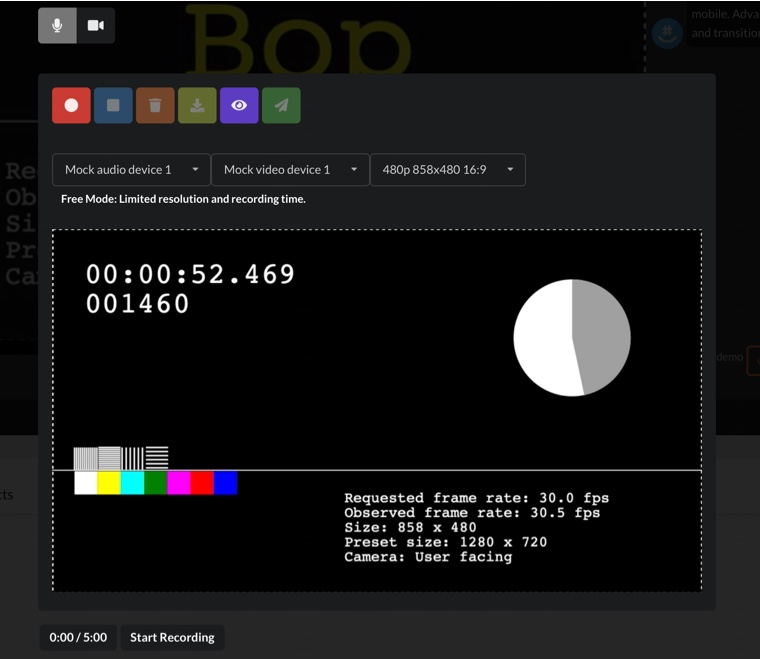

## Cam-Recorder-HTML5-Video-Audio : Video/Audio Recorder Camera/Microphone HTML5 - Standalone PHP
## November 2026 maintenance update

The bundled HTML5 Videochat app is built from source dated **2026.11.10**. The older recorder remains a compatibility example. For small group meetings use [Video Conference](https://demo.videowhisper.com/video-conference/); for webcam, microphone, screen capture and download-only recording use [the current recorder](https://demo.videowhisper.com/webcam-microphone-screen-recorder/). Neither requires Flash.

PHP 8.2+, Fileinfo, mbstring, HTTPS and PHP sessions are required. The example now validates a random browser session secret for every app request. Room roles come from the server session; knowing a room/user ID does not grant broadcaster access. State is stored outside the web root, and account tokens stay on the PHP host. Chat is bounded and recordings have randomized filenames, MIME/size checks, a 25 MB file limit, 100 MB/20 files per booth and 500 MB total upload quota. This remains a public developer demo, without a member/billing system. Accepted recordings are public to visitors with a booth or file URL; use synthetic test content only.

### Configure before installation

Set `VWH5_SOCKET`, `VWH5_ACCOUNT` and `VWH5_TOKEN` on the PHP host. The account token must never be placed in JavaScript, a public JSON file or this repository. Alternatively set `VWH5_CONFIG` to an operator-owned PHP file **outside the document root** that returns an options array containing `vwsSocket`, `vwsAccount` and `vwsToken`. `settings.php` contains safe defaults, not deployment credentials. Set `VWH5_STORAGE_DIR` to a private directory outside the web root; its default is a per-installation private temporary directory. Protect it with owner-only permissions and use a persistent location on public deployments.

In the streaming account, set the login callback to this installation's HTTPS `socket-auth.php` URL. The callback authenticates the server's private token and checks a five-minute, user-bound PIN. The React client renews through `task=socket_auth` after authenticating the browser session. Configure separate accounts for unrelated installations. `uploads/.htaccess` disables indexes, executable content and access to historical session/chat files; configure equivalent rules on non-Apache hosts. Also configure edge rate/connection limits and PHP `post_max_size`/`upload_max_filesize` consistently with the application limit.

Visitor page views no longer delete files. Schedule `php clean_older.php --days=1` using the PHP account. It deletes only expired randomized recordings created by the new uploader, skips symlinks and preserves historical filenames. Review older media separately before migrating or deleting it.

### Verify and update

Run `python3 tests/smoke.py` before publishing; it starts a loopback PHP fixture with synthetic credentials and private temporary storage. The checks cover sessions, guest/owner access, callback rejection, chat and private state. Then test two browser contexts with fake or consented devices, recording upload/playback where applicable, and the host's HTTPS/TURN configuration. Physical devices and separate networks need manual checks.

Human-readable React source, dependency lockfile and build scripts for the bundled assets are in `source/`. In that directory run `npm ci`, `npm run test:socket-auth`, then `NODE_OPTIONS=--openssl-legacy-provider DISABLE_ESLINT_PLUGIN=true GENERATE_SOURCEMAP=false npm run build`. Replace only generated `static/js`, `static/css` and referenced media, keeping license notices. The legacy CRA build toolchain has known development-only audit findings; never expose its development server publicly. Runtime dependency audit passed on 2026-11-10.

Publishing uses an explicit runtime/source allowlist. Exclude `.env*`, editor/SFTP settings, private configuration, uploads, logs, recordings, tests results and dependency folders. Back up the installed runtime and private configuration first, upload the tested assets and PHP files together, verify the version banner and test login/chat/media, and restore the previous runtime if verification fails. Never synchronize customer recordings or delete historical media during an update.

[Live Demo: Cam/Mic/Screen Video/Audio Recorder HTML5 - Standalone PHP](https://demo.videowhisper.com/cam-recorder-html5-video-audio/)

Before installing, test the simple setup in the live demo:
[Cam/Mic Recorder HTML5 - Live Demo](https://demo.videowhisper.com/cam-recorder-html5-video-audio/)

This edition implements audio / video recording in an instant recording booth. Can record Webcam + Microphone Video, Screen + Microphone Video, Microphone Audio.

### Standalone PHP Edition Features: Cam Recorder HTML5

- [x] Instant recording booth
- [x] Access recorder with a button
- [x] List recordings (video, audio)

### Video/Audio Recorder HTML5 Features

- [x] Toggle Microphone/Webcam/Screen recording mode
- [x] Select Microphone, Camera, Resolution
- [x] Playback recording
- [x] Discard and start recording again if needed
- [x] Download recording
- [x] Send (upload) recording to server
- [x] 100% web based in all major HTML5 browsers

### Installation Instructions

Requirements: Regular web hosting with PHP. Recording does not involve live streaming requirements. This edition does not implement conversions.

1.  Deploy files to your web installation location. (Example: yoursite.domain/cam-recorder-html5-video-audio/)
4. Give the PHP account ownership of its private state directory (0700). Public recording files use 0755 directories and 0644 files; do not use world-writable permissions.

### Compatible Turnkey Hosting with Free Installation

- [Live Streaming Hosting](https://webrtchost.com/hosting-plans/) - includes live streaming servers, web hosting with video conversion
- [Video Hosting](https://videosharevod.com/hosting/) - web hosting with video conversions

### Plain PHP Edition Limitations

- The plain php edition refers to minimal scripts to showcase recording video and audio.
- Plain php edition does not involve database and systems to manage members, rooms, billing. These depend on framework you want to integrate, plugins, database, member system.
- See [Turnkey HTML5 Videochat Site](https://paidvideochat.com/html5-videochat/) edition, available as WordPress plugin with full php source. Includes user role management (performers/clients), pay per minute, integrates billing wallets.

### Main Integration Scripts

- index.php : room booth page with Recorder button, recordings, accessed directly creates a recording booth and shows room link to access later
- recorder.php : embeds video / audio recorder app
- app-call.php is called by application to retrieve parameters, interact with web server, update status and chat (ajax calls)
- app-functions.php functions implementing features for app-call.php , including translated texts, app settings

Scripts also contain comments for clarifications/suggestions.

### VideoWhisper HTML5 Project Demos

- [Video Call - HTML5 Videochat - Standalone](https://demo.videowhisper.com/videocall-html5-videochat-php/)
- [Live Streaming - HTML5 Videochat - Standalone](https://demo.videowhisper.com/html5-videochat-php/)
- [Cam/Mic Recorder HTML5 - Standalone](https://demo.videowhisper.com/cam-recorder-html5-video-audio/)
- [PaidVideochat Turnkey Site](https://paidvideochat.com/demo/)

### VideoWhisper HTML5 Project Downloads

- [Video Call - HTML5 Videochat - GitHub](https://github.com/videowhisper/VideoCall-HTML5-Videochat-PHP)
- [Live Streaming - HTML5 Videochat - GitHub](https://github.com/videowhisper/HTML5-Videochat-PHP)
- [Cam/Mic Recorder HTML5 - GitHub](https://github.com/videowhisper/Cam-Recorder-HTML5-Video-Audio)
- [PaidVideochat Turnkey Site - WordPress](https://wordpress.org/plugins/ppv-live-webcams/)

For a free consultation, [Contact VideoWhisper Technical Support](https://consult.videowhisper.com).
